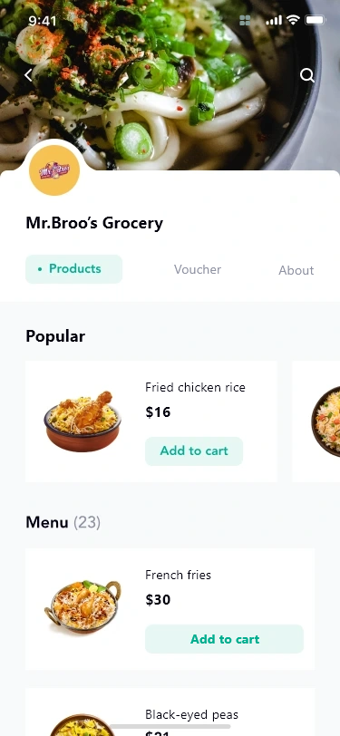
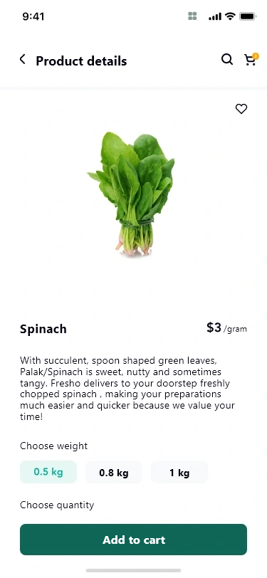
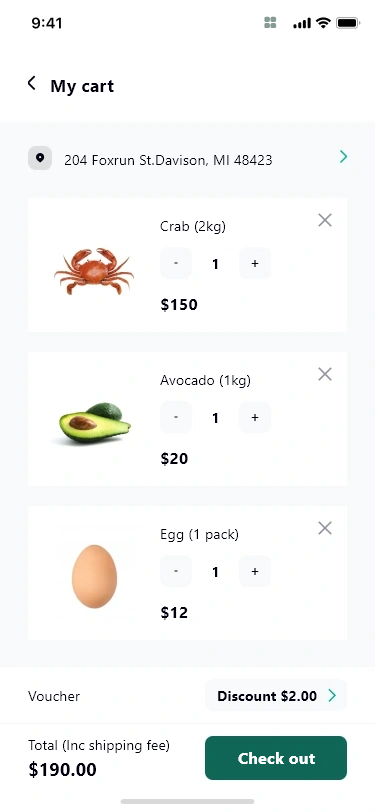
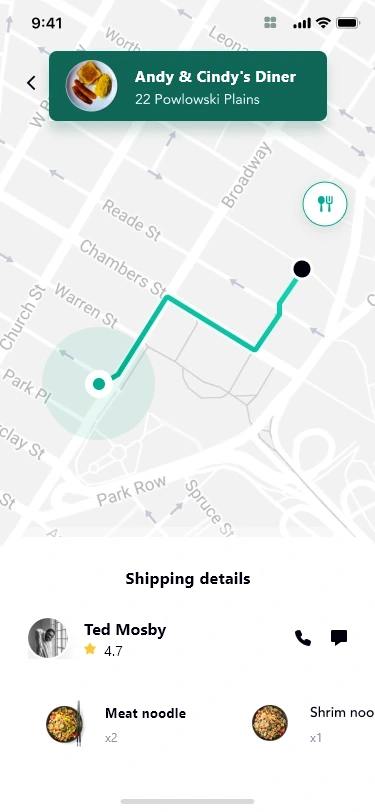

# Fooddoor · Flutter 外卖与生鲜演示

Fooddoor 将点餐、生鲜采购和订单配送串在同一个移动端界面中。可从引导页进入首页、浏览餐厅、查看商品，也可在购物车修改数量并打开配送进度。界面文案沿用 Pixso 的英文设计。

| 餐厅菜单 | 生鲜商品 | 购物车 | 配送详情 |
| :---: | :---: | :---: | :---: |
| [](docs/screenshots/B05.png) | [](docs/screenshots/D11.png) | [](docs/screenshots/D14.png) | [](docs/screenshots/C04.png) |

[查看全部 65 张 Flutter 界面截图](docs/SCREENS.md)

## 运行

使用 Flutter 3.47.7、Dart 3.13.5 开发。项目包含 Android 和 Web 入口。在项目根目录执行下列命令，最后一条的设备 ID 替换为上一条列出的已有设备。

```sh
flutter pub get
flutter devices
flutter run -d <device-id>
```

也可用 `flutter run -d chrome` 在浏览器中体验。运行应用无需启动 Pixso。进入后，点击引导画面继续，或点击顶部的小方格，按名称打开任意画板。购物车的加减按钮会更新数量和合计。搜索页可输入 `rice` 体验结果页，输入未匹配的词可查看空结果。

## 设计范围

| 分组 | 画板 | 包含的界面 |
| --- | --- | --- |
| A | A01–A08（8） | 启动、引导、欢迎、登录及注册 |
| B | B01–B19（19） | 首页、合集、餐厅、菜品与配料、配送时段、地图、搜索筛选和评价 |
| C | C01–C09（9） | 进行中与历史订单、配送时间线、骑手位置、消息、通话和账单 |
| D | D01–D18（18） | 超市、优惠、门店、分类、商品、购物车、配送地址与匹配骑手 |
| E | E01–E11（11） | 账户、优惠券、银行卡、设置、地址、收藏与二维码 |

页面取自当前 Pixso 文件的 `Design` 分类。`Style → Text style` 提供 Avenir Roman、Heavy、Black 等字样。运行时可编辑文本和原生文本使用平台字体回退，字形和换行与 Avenir 会有差异。

## 项目结构与架构

| 路径 | 职责 |
| --- | --- |
| `lib/main.dart` | 初始化应用，保存当前会话的输入值和访问历史，处理返回和画板目录。 |
| `lib/catalog.dart` | 加载布局清单，将 A01–E11 映射到画板标题、尺寸及图层。 |
| `lib/screen.dart` | 按画板宽度等比布局，渲染文字、输入框、图像及交互区域，处理滚动、搜索和数量变更。 |
| `lib/routes.dart` | 定义文字按钮、无文字图标和商品卡片的跳转目标。 |
| `assets/layout.json` | 保存各画板的文字内容、字号、颜色和原稿坐标。 |
| `assets/screens/` | 保存每个画板的 WebP 美术底图，包括照片、插画、地图和部分装饰文字。 |
| `android/`、`web/` | Android 工程和浏览器入口。 |
| `tool/capture.dart` | 使用 Flutter 渲染同一个页面组件，按画板尺寸输出 PNG。 |
| `tool/smoke.dart` | 用 Flutter 测试引擎检查页面跳转、搜索词、消息发送和购物车合计。 |
| `docs/screenshots/` | 65 张 Flutter 渲染截图，只用于文档展示。 |

应用启动时读取一次布局清单。打开画板后，共用页面组件先铺上美术底图，再按原稿坐标绘制原生文字、输入框和操作区域。点按按钮由页面控制器更新历史栈；购物车数量、表单内容和演示消息保存在当前会话内。375 像素为设计基准宽度，长页支持纵向滚动。

## 验证与实现边界

65 个画板均使用本机 Flutter 桌面测试引擎渲染并导出 PNG，长页截图包含滚动区域。可以从项目根目录运行以下检查：

```sh
dart analyze lib tool
flutter run -d flutter-tester -t tool/smoke.dart
flutter run -d flutter-tester -t tool/capture.dart
```

回归检查覆盖欢迎页进入登录和首页、修改搜索词后切换结果与空结果、连续发送两条相同消息、增加购物车数量，以及从结账进入骑手匹配后返回购物车。购物车示例中，螃蟹数量从 1 加到 2 时，总价从 $190.00 变为 $340.00。消息保存在当前会话，点击发送箭头或提交输入框均可发送。

本次已通过 Dart 静态分析和 Flutter 测试引擎回归检查，并使用 Flutter Web 的平台库将应用入口编译为 JavaScript。完整 Web 构建和浏览器运行仍待验证。当前环境未列出可用的 Android 虚拟设备，ADB 服务启动失败，Android 安装、系统返回手势和软键盘遮挡也待设备验证。

这是基于固定画板的交互演示。商品、价格、位置与配送状态使用示例数据。登录、支付、通话和实时地图没有接入外部服务。商品页的加购按钮用于打开示例购物车，购物车内的三件商品支持数量调整。搜索根据内置关键词展示预设结果。应用重启会恢复示例状态。
